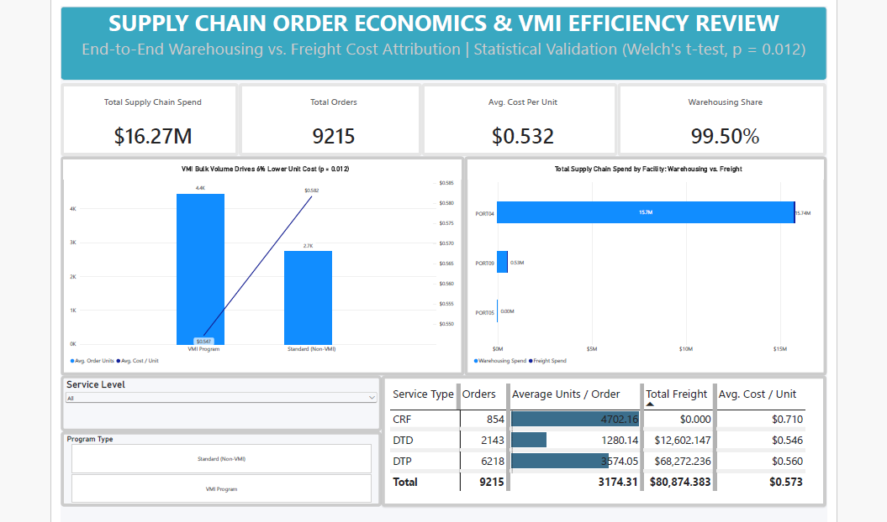

# Supply Chain Order Economics & VMI Efficiency Review

<p align="center">
  
</p>

## Executive Summary
Analyzed **9,215** historical supply chain orders **($16.27M total logistics spend)** to test whether **Vendor Managed Inventory (VMI)** actually reduces unit shipping and storage costs compared to standard ordering. On integrating various tools such as SQL modeling, hypothesis testing in Python, and an interactive Power BI executive dashboard, the analysis proves that VMI bulk shipping drives a **statistically significant 6.0% reduction in per-unit cost ($p$ = 0.012)**.

## Key Business Insights
* **Warehousing Dominates Spend (99.50%):** Warehousing accounts for 99.50% of total supply chain costs, while freight represents just **$80,874** (0.50%).
* **Extreme Facility Concentration (`PORT04`):** `PORT04` drives **$15.74M (~97%)** of total spend, making it the primary lever for operational optimization.
* **VMI Unit-Cost Advantage ($p = 0.012$):** VMI shipments average **4.4K units/order** compared to **2.7K units/order** for Standard (Non-VMI) orders. Welch’s two-sample t-test ($t = -2.50, p = 0.012$) confirms that VMI's larger batch sizes reduce average unit cost by **6%** (**$0.547** vs. **$0.582** per unit).
* **Service-Tier Storage Overhead (`CRF`):** Customer-Routed Freight (`CRF`) orders incur **$0.000** in freight charges yet carry the highest unit cost (**$0.710/unit**) due to extended warehousing/storage costs compared to `DTD` (**$0.546**) and `DTP` (**$0.560**).

## Technical Architecture
1. **Data Engineering & Auditing (SQLite):** Cleaned string-formatting anomalies across raw relational tables and built `vw_order_economics` to calculate order-level freight rates, warehousing costs, and VMI flags. Handled **CRF** (Customer-Routed Freight) orders where freight cost is **$0.00** so they wouldn't skew per-unit cost calculations.
2. **Feature Engineering & Statistical Validation (Python / Pandas / SciPy):** Engineered `cost_per_unit` and conducted Welch’s two-sample t-test (`equal_var=False`) to account for unequal variances and sample sizes between VMI and Non-VMI cohorts.
3. **Executive BI Storytelling (Power BI / Power Query / DAX):** Built an interactive Z-pattern dashboard featuring Power Query M transformations, DAX spend-share measures, facility breakdowns, and a service-level drill-down matrix.

## Strategic Recommendations
1. **Expand VMI Enrollment at `PORT04`:** Transition high-frequency Standard customers at `PORT04` into VMI bulk replenishment to capture the validated 6% unit-cost reduction.
2. **Audit `CRF` Warehousing Dwell Time:** Investigate why `CRF` orders accumulate $0.710/unit in storage costs despite zero company-paid freight, and tighten pickup SLAs.

## Data Source
[Supply Chain Logistics Problem Dataset](https://data.mendeley.com/datasets/w497c46995/1) — 9,215 order records across 7 relational tables (`OrderList`, `FreightRates`, `WhCosts`, `WhCapacities`, `ProductsPerPlant`, `VmiCustomers`, and `PlantPorts`).

## How to Run This Project

### 1. Prerequisites
* **SQLite3** (or DB Browser for SQLite)
* **Python 3.10+** with `pandas`, `numpy`, and `scipy` installed (`pip install pandas numpy scipy jupyter`)
* **Microsoft Power BI Desktop** (Windows)

### 2. Rebuild the SQL Views (Optional)
A pre-built database is included in `data/processed/supply_chain.db`. To rebuild the views from scratch against the raw CSVs:
```bash
sqlite3 data/processed/supply_chain.db < sql/01_schema_and_audit.sql
sqlite3 data/processed/supply_chain.db < sql/02_vw_order_economics.sql
